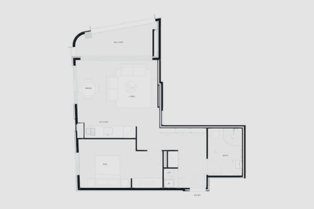

# Unit 101

From a floor plan to a place you can walk through.



A small architectural study by [Charlie Holland](https://charlieholland.com/). Explore the same apartment as a drawing, a 3D cutaway and a first-person walkthrough. The animation is captured from the actual model.

[Try the walkthrough](https://unit-101-charlie-holland.milky-cedar-4476.chatgpt.site/walkthrough.html?view=overview) · [Download the full GIF](media/unit-101.gif)

## Explore

- **Floor plan:** understand the layout and room relationships.
- **3D overview:** rotate the apartment and inspect it from above.
- **Walk through:** move at eye level, jump between rooms or play the guided tour.

Built with Three.js and plain JavaScript. Keyboard, mouse and touch controls are supported. No accounts, API keys or external services are needed to run it.

## Run locally

Use Node.js 20 or newer.

```sh
git clone https://github.com/CarlHolland93/unit-101.git
cd unit-101
npm ci
npm start
```

Open **http://127.0.0.1:8080**. In first person, use W/A/S/D or the arrow keys to move, drag to look, and Q/E to turn. Room shortcuts and the guided tour offer another way to explore.

## Open offline

Download [`dist/unit-101-walkthrough.html`](dist/unit-101-walkthrough.html) with GitHub's **Download raw file** button, then open the saved file in a browser with WebGL enabled. The model, textures, scripts and credits are embedded in that one file.

## Build and check

```sh
npm run build
npm test
```

The build updates the self-contained offline viewer. To run the browser checks, stop the local server, run `npm run qa`, and open **http://127.0.0.1:8080/qa.html**.

## Recreate the animation

The preview uses a gradual blueprint reveal, a 3D orbit and an eased camera descent into the living room. Lighting and the ceiling blend in as the camera enters. It continues into the application's guided walkthrough at 25 frames per second.

Optional capture tools require Python 3, Pillow and Playwright:

```sh
npm install --no-save playwright@1.62.1
npx playwright install chromium
python3 -m venv .venv
.venv/bin/python -m pip install Pillow
```

With `npm start` running in another terminal:

```sh
node scripts/capture-preview.cjs
.venv/bin/python scripts/assemble-preview.py
```

Frames and verification data are written to `build/preview-frames/`; GIFs go to `media/`. Set `UNIT101_BROWSER=chrome` to capture with an installed Google Chrome, or `UNIT101_CAPTURE_URL` to use another local server address. The capture requires WebGL support. Rendering speed depends on the graphics hardware.

## What's here

| Folder | Contents |
| --- | --- |
| `src/` | Viewer, sample plan and model, Three.js and texture assets |
| `scripts/` | Local server, offline build and animation capture |
| `tests/` | Tour, packaging and browser checks |
| `dist/` | Downloadable offline viewer |
| `media/` | Plain transformation GIFs |

The layout comes from a supplied 2D drawing. Ceiling height, finishes, lighting and vertical furniture details are illustrative. This is an example of spatial exploration, not a construction model.

## License and credits

Original application code, tooling and documentation are [MIT licensed](LICENSE). The supplied architectural design and its derived example assets are excluded from that grant; see [asset notices](ASSET_NOTICES.md). Three.js and the texture libraries retain their own licenses and credits in [third-party notices](THIRD_PARTY_NOTICES.md).
